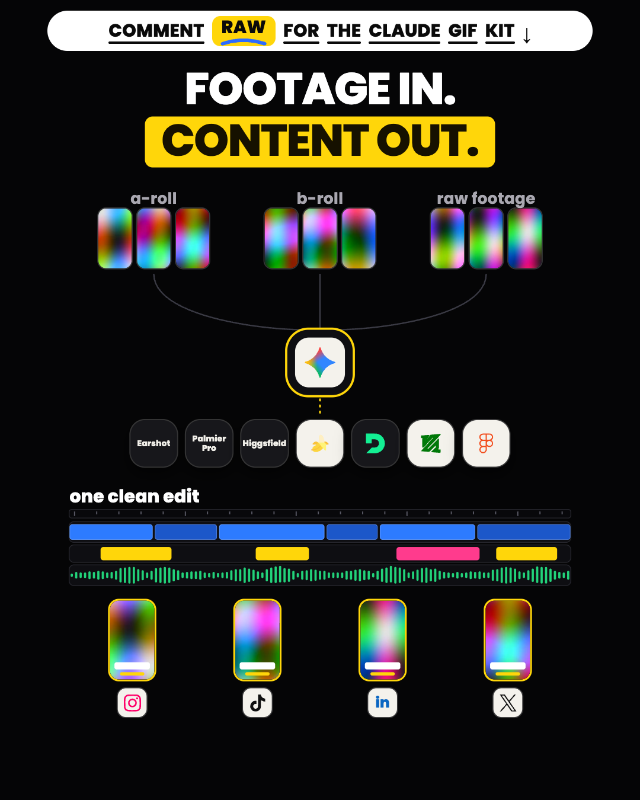

# Claude GIF Kit

The exact setup behind the animated explainer GIF from the post "Rate your last AI edited video out of 10":

- a **Remotion project** (`src/Pipeline.tsx`): footage tiles feed a square container where four agent logos take turns,
  one row of tool logos, a three track timeline, finished clips that fly out to four platforms, a comment strip with an
  underline pass, and an end screen. 1080 by 1350, 60 fps, every frame a pure function of the frame number;
- the **prompts** that built it, the **footage prompts**, the **design rules**, and the **GIF recipe** that fixes
  choppy GIFs (50 fps with every frame exactly 20 ms);
- a **Claude Code skill** that turns a sketch into this kind of animation;
- small **checkers and tests** (frame timing of a GIF, kit integrity).

The picture above is what `npm run still` renders on a fresh clone (placeholder clips, typeset name tiles for tools whose logos are not shipped).

## Start in 4 steps

1. Clone this repo and run `npm install`.
2. Run `npm run setup`. It makes 9 placeholder clips with ffmpeg (replace them with your own footage later).
3. Run `npm run still`, then open `out/main.png`. Run `npm run studio` to watch it move.
4. Tell Claude Code: **use the gif-from-a-sketch skill and rebuild this animation for my idea** and give it your sketch.

Needs Node 20 or newer, ffmpeg, Python 3.

## What is inside

| Path | What it is |
| --- | --- |
| `src/Pipeline.tsx` | The composition. Constants at the top: groups, tools, agents, platforms, words, timings |
| `docs/01` to `docs/07` | How it was made, the prompts, footage prompts, GIF recipe, design rules, licences, the comment ask |
| `scripts/make_gif.py` | Video to GIF with even frame timing and the finished still first |
| `scripts/check_gif_timing.py` | Tells you if a GIF has an uneven frame rhythm |
| `scripts/check_kit.py` | Checks the kit is complete and has no private links |
| `skills/gif-from-a-sketch` | The Claude Code skill |
| `tests/` | Unit tests for the scripts |

## Honest limits

- The footage tiles in the original were AI generated stock; this kit ships placeholders only.
- The timeline is decorative. It is not a real project.
- Results vary: a keyword inside a picture is not proven to be exempt from reach penalties. Measure.
- First pass tool: check every frame yourself before you post.

MIT licensed. Logos belong to their owners (see `docs/06-LOGOS-AND-LICENCES.md`).
